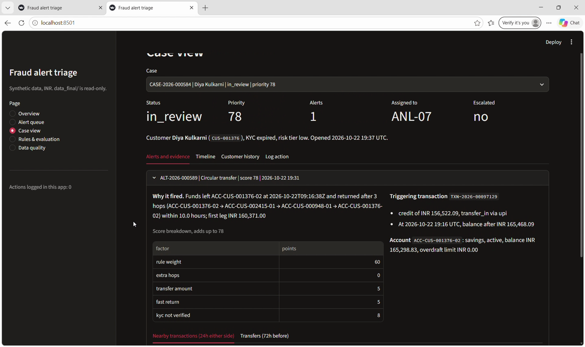
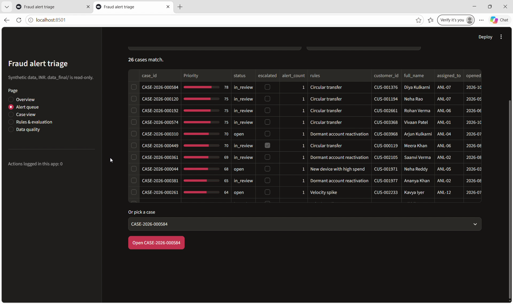
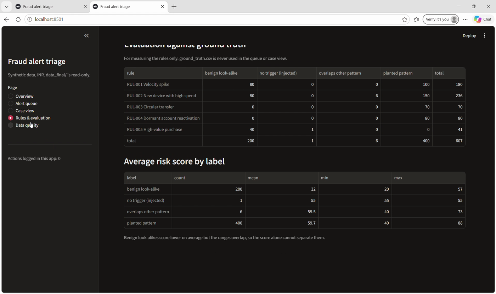
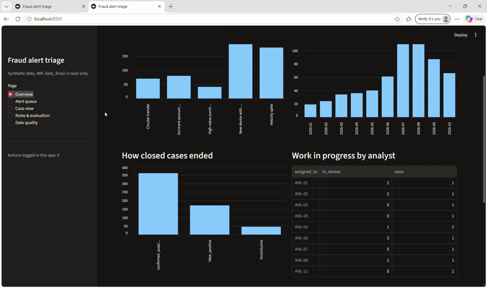
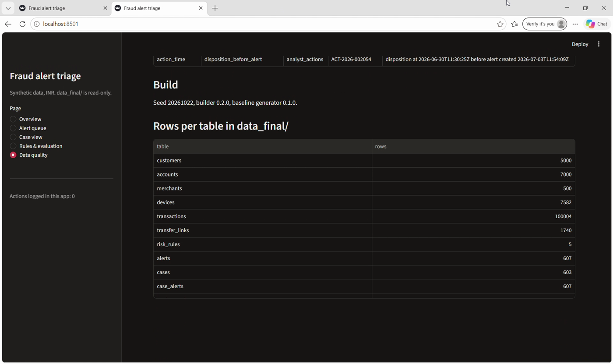

# Fraud Alert Triage Platform

Synthetic data generator, transparent rules engine and analyst triage app for transaction and linked-account risk alerts.
Built for the YottaFlex AI 72-hour code challenge (problem: *prioritize transactions and linked accounts for analyst review using transparent rules and synthetic risk indicators*).

**All data is synthetic.** No real people, accounts, merchants or devices. No external datasets are used (see [Source manifest](#source-manifest)).



## What it does

1. **Generates** a valid, reconciling baseline: 5,000 customers, 7,000 accounts, 100,000 transactions, transfers, devices and merchants, with planted risk patterns and benign look-alikes (`src/generator.py`).
2. **Evaluates 5 transparent rules**, scores every alert with an itemised breakdown, groups alerts into cases and simulates analyst actions (`src/build_triage.py`).
3. **Injects 5 labelled anomalies** after the clean baseline, each with a `ground_truth.csv` row (`src/build_triage.py`).
4. **Validates** keys, joins, enums, dates, balances and lifecycle, checks that every labelled anomaly is caught and nothing else is reported, and proves reproducibility (`src/validator.py`).
5. **Serves a Streamlit app** with a case queue, evidence view, analyst action logging, rule evaluation and data quality pages (`src/app.py`).

## Quick start

Needs Python 3.11 or newer. The generator uses `numpy`, the builder and validator use only the standard library, and the app uses `pandas` and `streamlit`.

```bash
git clone https://github.com/Niharika-bandlamudi/fraud-alert-triage-platform.git
cd fraud-alert-triage-platform
python -m venv venv
# Windows PowerShell:  venv\Scripts\Activate.ps1
# macOS / Linux:       source venv/bin/activate
pip install -r requirements.txt
```

The finished dataset is already committed in `data_final/`, so you can go straight to the app:

```bash
streamlit run src/app.py        # opens http://localhost:8501
```

To rebuild everything from scratch (about 25 seconds). In PowerShell, run these one at a time, not joined on one line:

```bash
python src/generator.py --seed 20261022 --out data    # clean baseline -> data/
python src/run_all.py                                 # build + validate + reproducibility -> data_final/
```

| Command | Purpose |
|---|---|
| `python src/generator.py --seed 20261022 --out data` | Full baseline (5,000 / 7,000 / 100,000) |
| `python src/generator.py --starter --out data_starter` | Starter dataset (500 / 700 / 10,000), same generator |
| `python src/generator.py --customers N --accounts N --transactions N --alerts N` | Any scale |
| `python src/build_triage.py --in data --out data_final` | Rules, alerts, cases, actions, injected anomalies |
| `python src/validator.py --data data_final` | Validation only |
| `python src/validator.py --data data_final --repro` | Validation plus two full rebuilds compared by hash |
| `python src/run_all.py` / `--quick` | Build + validate (`--quick` skips the reproducibility rebuilds) |
| `python src/export_sql.py` | SQLite database and SQL seed file -> `sql/` |

Tested with Python 3.11 on Windows (pandas 3.1.1, numpy 2.4.6, streamlit 1.67.0) and Python 3.12 on Linux (pandas 3.0.6, numpy 2.5.4). A fresh Linux run reproduced all 14 committed `data_final/` CSVs byte for byte.

## Repository layout

```
src/
  generator.py      Steps 1-2: master data, transactions, transfers, planted patterns -> data/
  build_triage.py   Steps 3-4: rules, alerts, scores, cases, actions, injected anomalies -> data_final/
  validator.py      Step 5: validation + reproducibility check (stdlib only)
  run_all.py        One command for build + validate
  export_sql.py     CSV to SQLite / SQL seed -> sql/
  app.py            Step 6: Streamlit UI
  app_data.py       Plain-pandas data layer for the app (testable without Streamlit)
data/               Clean baseline (never modified after generation)
data_final/         Full dataset: baseline + rules, alerts, cases, actions, anomalies
docs/
  data_dictionary.md  Every entity: type, required, allowed values, uniqueness, validation
  assumptions.md      Assumptions, rule definitions, known limitations
  screenshots/        App screenshots
prompts/prompts.md  Prompt history (AI use)
```

## Data model

14 tables: the 10 required entities plus four supporting tables.

- `Customer` 1:N `Account` 1:N `Transaction`; `Account` 1:N `AccountStatusHistory`; `Customer` 1:N `Case`
- `Device` N:M `Account` via `DeviceAccountLink`; `Merchant` 1:N `Transaction`
- `TransferLink` joins a source debit and a destination credit
- `RiskRule` 1:N `Alert`; each `Alert` points to one triggering `Transaction`
- `Case` N:M `Alert` via `CaseAlert` (in this data every alert is in exactly one case); `Case` 1:N `AnalystAction`

Primary keys, foreign keys, enums, effective dates and lifecycle states are in [docs/data_dictionary.md](docs/data_dictionary.md).
IDs follow the brief: `CUS-000001`, `ACC-CUS-000001-01`, `TXN-2026-00000001`, `ALT-2026-000001`, `CASE-2026-000001`.
State changes are appended as new rows (`AccountStatusHistory`, `AnalystAction`); nothing is overwritten.

## Rules and scoring

| Rule | Fires when | Weight |
|---|---|---|
| RUL-001 Velocity spike | 8 or more debits on one account within 60 minutes | 40 |
| RUL-002 New device with high spend | First use of a device (after 5+ earlier transactions), then 25,000+ of debits within 24 hours | 45 |
| RUL-003 Circular transfer | Funds return to the origin account through 3-4 hops within 72 hours | 60 |
| RUL-004 Dormant reactivation | First transaction after 90+ dormant days is a debit of 25,000+ | 50 |
| RUL-005 High-value purchase | Single purchase of 100,000+ (suppressed if RUL-004 already alerts it) | 25 |

`risk_score` = rule weight + context points (burst size, amount, customer risk tier, unverified KYC, high-risk merchant) minus mitigating points (utilities-only payees, known payees), kept within 0-100. The itemised breakdown is stored on every alert and always adds up exactly, so every rank can be explained.
Alerts of one customer join the same case while each is within 7 days of the previous one. Case priority = highest alert score + 5 per extra alert, capped at 100.

**Rules never read `ground_truth.csv`.** Labels are used afterwards to measure detection and on the app's evaluation page. (Simulated analyst dispositions are derived from labels with noise, by design; see limitations.)

## Injected anomalies and ground truth

The clean baseline is generated first. Then five anomalies are appended with higher IDs on accounts they cannot disturb, each with a `ground_truth.csv` row (`label_kind = injected_anomaly`):

| ID | Anomaly | Entity |
|---|---|---|
| INJ-01 | Transaction on a closed account | `TXN-2026-00100001` |
| INJ-02 | Negative balance without overdraft | `TXN-2026-00100002`, `ACC-CUS-001209-01` |
| INJ-03 | Transfer legs do not reconcile (31,720.00 vs 30,996.00) | `TRF-2026-001740` |
| INJ-04 | Alert with no triggering transaction | `ALT-2026-000607` |
| INJ-05 | Case disposition before the alert | `ACT-2026-002054` |

INJ-02 produces two findings (the transaction and the account balance), so the validator reports 6 findings for 5 injections.
`ground_truth.csv` also labels planted patterns and benign look-alikes (3,396 rows: 2,479 planted pattern, 911 false positive, 6 injected anomaly).

## Verification results

Run on a fresh copy (generator, then `run_all.py`):

| Check | Result |
|---|---|
| Primary keys, foreign keys, enums, date order, balance reconciliation, lifecycle, duplicates | pass |
| Labelled anomalies caught | **6 / 6**, unexpected findings **0** |
| Planted patterns detected by rules | velocity 100/100, new device 150/150, circular 70/70, dormant 80/80, benign look-alikes 200/200 |
| Reproducibility | run 1 == run 2, and rebuild == committed `data_final/` |
| Final result | `RESULT: PASS` |

`data_final/build_manifest.json` holds the seed, row count and SHA-256 of every file. Row counts:

| Table | Rows | Table | Rows |
|---|---|---|---|
| customers | 5,000 | risk_rules | 5 |
| accounts | 7,000 | alerts | 607 |
| account_status_history | 7,974 | cases | 603 |
| merchants | 500 | case_alerts | 607 |
| devices | 7,582 | analyst_actions | 2,054 |
| device_account_links | 15,008 | transfer_links | 1,740 |
| transactions | 100,004 | ground_truth | 3,396 |

Alerts by rule and label: RUL-001 180 (100 planted, 80 false positive); RUL-002 236 (150 planted, 6 overlap with other patterns, 80 false positive); RUL-003 70 planted; RUL-004 80 planted; RUL-005 40 false positive plus the 1 injected trigger-less alert.
Average score: planted pattern 59.7, benign look-alike 32. The ranges overlap (benign 20-57, planted 40-88), so score alone does not separate them. This is documented, not hidden.
Cases: 577 closed, 15 in review, 11 open.

## The app

Run `streamlit run src/app.py`. `data_final/` is read-only; actions logged in the app go to `app_state/new_actions.csv` (git-ignored) and never change the dataset, so `run_all.py` still passes after using the app.

| Page | What it shows |
|---|---|
| Overview | Alerts by rule, alerts per month, how closed cases ended, open work per analyst |
| Alert queue | Cases ranked by priority with filters; open a case |
| Case view | Why each alert fired, itemised score breakdown, triggering transaction, account state, nearby transactions, transfers, timeline, customer history, **Log action** form |
| Rules & evaluation | Alerts by rule vs ground-truth label, average score by label |
| Data quality | Rows per table, validation findings with entity IDs, build seed and versions |

| Alert queue | Rules & evaluation |
|---|---|
|  |  |

| Overview | Data quality |
|---|---|
|  |  |

## Deviations from the brief

- **Alert volume is 607, not 1,000.** Alerts come only from the five rules, and they fire on 607 of the 100,000 transactions (planted patterns plus labelled benign look-alikes). The generator's `--alerts` option scales the planted pattern counts rather than forcing an exact alert total, because forcing 1,000 would require alerts with no triggering rule, which breaks "every alert references triggering facts/rules". Raising the pattern counts in `generator.py` raises the alert count.
- **Transactions are 100,004** in `data_final/` (100,000 baseline plus 4 injected rows).
- `ACC-<customer-id>-01` is read literally as `ACC-CUS-000001-01`.
- Extra tables beyond the 10 entities: `DeviceAccountLink`, `CaseAlert`, `AccountStatusHistory`, `ground_truth`.

More assumptions and the exact rule definitions: [docs/assumptions.md](docs/assumptions.md).

## Known limitations

- Rules are fixed thresholds, not learned. 6 of 236 RUL-002 alerts overlap other patterns.
- Every alert comes from a planted pattern or a labelled look-alike; there is no unlabelled background noise.
- Analyst names, notes and timings are synthetic templates. Dispositions are simulated from labels with noise (92% and 90%), so they are not an independent measure of rule quality.
- Pattern labels exist for transactions and transfers; alerts and cases are judged through their triggering transaction.
- Single currency (INR). The snapshot date is fixed at 2026-11-05, so output never depends on the wall clock.
- The app has no authentication and no automated tests; it was checked manually (see screenshots) and its data layer is plain pandas.

## Source manifest

No external or public datasets, APIs or third-party code were used for data. Dependencies: `pandas`, `numpy`, `streamlit` (see `requirements.txt`). Names, IDs, merchants, devices and amounts are generated from templates and a seeded random generator.

## AI usage disclosure

Tool: **Claude (claude.ai)**. Full prompt history: [prompts/prompts.md](prompts/prompts.md).

- **Where AI accelerated the work:** schema and data dictionary, first drafts of the generator, rules/builder, validator and Streamlit app, and the README and prompt log.
- **Where I relied on it most:** the first drafts of `generator.py`, `build_triage.py`, `validator.py` and `app.py`.
- **What I personally did:** set up the repository, environment and git history; ran every step on my own machine and shared the real terminal output for review; fixed the command errors I hit; checked results against the brief (row counts, the five anomalies, `RESULT: PASS`); tested the app, including the Log action feature.

I ran every step on my own machine, fixed the command errors I hit, checked the results against the brief (row counts, the five anomalies, RESULT: PASS) and tested the Log action feature in the app.

### Prompt-history limitation

claude.ai chats cannot be exported as a prompt-only file, so `prompts/prompts.md` is a numbered record of each prompt I sent, summarised rather than copied verbatim.
